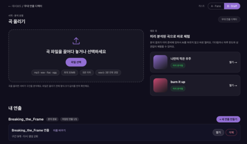
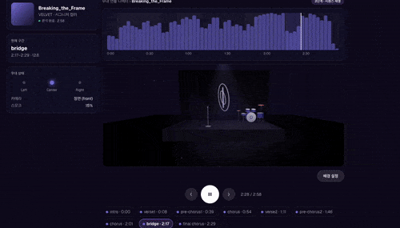
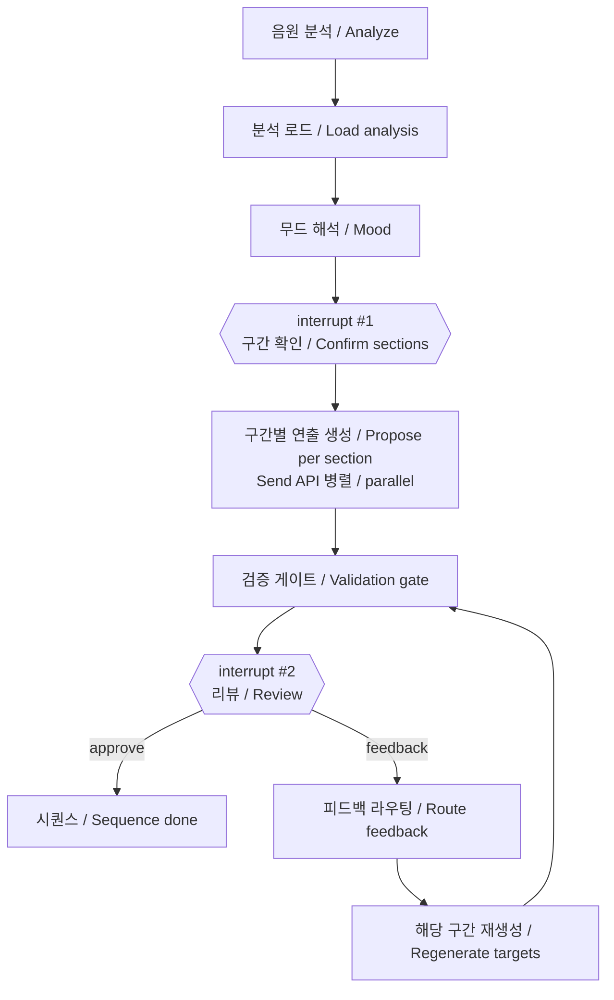

# Stage Director Agent

음원을 분석해 구간별 무대 연출(조명·색상·스모그·카메라)을 제안하고, 사람이 두 번 확인해 다듬는 **human-in-the-loop 에이전트 서비스**입니다. [STAGE.ONE (on-stage)](https://github.com/areumz/on-stage)의 무대 연출 툴과 연동되는 Python(LangGraph) 백엔드입니다.

A **human-in-the-loop agent service** that analyzes a music track, proposes per-section stage lighting (spots, color, smoke, camera), and lets a human review it twice before saving. It is the Python (LangGraph) backend for the stage tool in [STAGE.ONE (on-stage)](https://github.com/areumz/on-stage).

* * *

## 데모 / Demo




> 🔗 **라이브 데모 / Live demo**: [on-stage-nine.vercel.app/staff/login](https://on-stage-nine.vercel.app/staff/login)
> 스태프 계정으로 로그인하면 무대 연출 에이전트를 사용할 수 있습니다.
> Log in with a staff account to use the stage director agent.

### 데모 계정 / Demo Account

- ID: `demo@onstage.local`
- PW: `demo1234`

* * *

## 소개 / Introduction

**코드가 측정하고, LLM이 해석하고, 사람이 확정합니다.**

**Code measures, the LLM interprets, a human decides.**

- **근거 있는 판단**: librosa로 BPM·비트·에너지 곡선을 측정하고, LLM은 그 수치를 근거로 연출을 정합니다. 구간마다 `rationale`(이유)이 함께 나옵니다.
- **사람이 두 번 개입**: ① 자동 검출된 구간 경계를 확인·수정 → ② 구간별 제안을 미리보기하고 승인 또는 자연어 피드백.
- **부분 재생성**: "코러스만 다시"라고 하면 선택한 구간만 다시 만들고, 나머지는 그대로 유지합니다.
- **검증 게이트**: 범위 보정(clamp)과 규칙 검사(예: 잔잔한 구간 밝기 ≤ 500)를 거쳐, 위반 구간은 자동으로 최대 2회 재생성합니다.

<br>

- **Grounded decisions**: librosa measures BPM, beats and the energy curve; the LLM decides lighting from those numbers and attaches a `rationale` to every section.
- **Two human checkpoints**: (1) confirm/edit detected section boundaries, (2) preview proposals, then approve or give natural-language feedback.
- **Partial regeneration**: "redo only the chorus" regenerates the selected sections and leaves the rest byte-for-byte unchanged.
- **Validation gate**: values are clamped and rule-checked (e.g. calm sections must stay ≤ 500 brightness); violating sections are auto-regenerated up to 2 times.

* * *

## 워크플로우 / Workflow



- 분석은 그래프 밖의 일반 Python 작업이며 결과는 파일 해시로 캐싱됩니다.
- Analysis runs outside the graph as a plain background job; results are cached by file hash.
- 모든 작업은 **접수(202) 후 폴링** 방식이고, 상태는 Postgres 체크포인터에 저장되어 다른 HTTP 요청에서 이어집니다.
- Every job is **accepted (202), then polled**; state lives in a Postgres checkpointer so a later request can resume the thread.

* * *

## 기술 스택 / Tech Stack

| 영역 / Area | 선택 / Choice |
| --- | --- |
| 에이전트 / Agent | LangGraph (`langgraph` 1.2) |
| 언어 / Language | Python ≥ 3.12 |
| API | FastAPI + Uvicorn |
| 음원 분석 / Audio | librosa, soundfile, numpy |
| LLM | Google Gemini (`google-genai`), 주 모델 + 예비 모델 / primary + fallback |
| 체크포인터 / Checkpointer | PostgreSQL (`langgraph-checkpoint-postgres`) — 로컬 Docker, 운영 Neon / local Docker, Neon in prod |
| 검증 / Validation | pydantic |
| 테스트·린트 / Test & Lint | pytest, ruff, GitHub Actions |
| 배포 / Deploy | Google Cloud Run (asia-southeast1) |
| 패키지 관리 / Packaging | uv |

* * *

## 로컬 실행 / Local Development

```bash
uv sync                                   # 의존성 설치 / install deps
cp .env.example .env                      # 값 채우기 / fill in values
docker compose up -d checkpointer-db      # 로컬 Postgres (포트 5433) / local Postgres
uv run --env-file .env uvicorn --factory stage_director.api:create_app --reload
```

1. `.env` 에 `INTERNAL_API_KEY`(`openssl rand -hex 32` 권장), `GEMINI_API_KEY`, `DATABASE_URL` 을 채웁니다.
2. 무료 Gemini 키는 모델당 분당 5회라 `GEMINI_RPM=4` 로 낮춰야 합니다. 유료 Tier 1 기본값은 10 입니다.
3. 운영 DB 를 로컬 `.env` 에 연결하지 마세요. 서버가 시작할 때 진행 중이던 작업을 모두 `interrupted` 로 바꿉니다.

<br>

1. Fill in `INTERNAL_API_KEY` (use `openssl rand -hex 32`), `GEMINI_API_KEY` and `DATABASE_URL` in `.env`.
2. Free Gemini keys allow 5 requests/min per model, so set `GEMINI_RPM=4`. The default 10 assumes paid Tier 1.
3. Never point a local `.env` at the production DB: on startup the server marks all in‑flight jobs `interrupted`.

### 테스트 / Tests

```bash
uv run ruff check .
uv run pytest                                      # 기본: LLM·Postgres 제외 / excludes LLM & Postgres
docker compose up -d checkpointer-db && uv run --env-file .env pytest -m postgres
uv run --env-file .env pytest -m llm               # 실제 Gemini 호출 / calls real Gemini
```

### 시드 곡 분석 / Seed-track analysis

```bash
uv run python -m stage_director.analysis.seed demo-tracks/*.mp3 --out seed-analysis
uv run python scripts/make_example_sequence.py     # 규칙 기반 예시, Gemini 미사용 / rule-based, no LLM
```

* * *

## API

모든 요청에 `X-Internal-Key` 헤더가 필요합니다(`/health`, `/ready` 제외). 요청·응답은 camelCase JSON입니다.

All requests need the `X-Internal-Key` header (except `/health`, `/ready`). Requests and responses are camelCase JSON.

| 메서드 / Method | 경로 / Path | 설명 / Description |
| --- | --- | --- |
| POST | `/analyze` | 음원 분석 시작 (202) / start audio analysis |
| GET | `/analyze/{jobId}` | 분석 상태·결과 / analysis status & result |
| POST | `/runs` | 시퀀스 생성 시작 (202) / start sequence generation |
| GET | `/runs/{threadId}` | 상태, interrupt, 결과 / status, interrupt, result |
| POST | `/runs/{threadId}/resume` | `sections` · `feedback` · `approve` 로 재개 / resume the graph |
| GET | `/health`, `/ready` | 프로세스 / DB 확인 / liveness & DB readiness |

`/propose` 는 동기 방식(최악 약 6분)이라 서버리스 환경에서는 쓰지 않습니다. `/propose` is synchronous (up to ~6 min) — use `/runs` instead.

자세한 계약·에러 코드·제한은 [docs/on-stage-handoff.md](docs/on-stage-handoff.md) 를 참고하세요.
Full contract, error codes and limits: [docs/on-stage-handoff.md](docs/on-stage-handoff.md).

| 제한 / Limit | 값 / Value |
| --- | --- |
| 음원 크기 / File size | ≤ 30 MiB |
| 길이 / Duration | ≤ 300 s |
| 형식 / Formats | mp3 · wav · flac · ogg |
| 구간 수 / Sections | 1–12 (각 8초 이상 / ≥ 8 s each) |

* * *

## 배포 / Deployment

Google Cloud Run 한 대(최대 인스턴스 1, `--no-cpu-throttling`, 유휴 시 0대)에 올립니다. 시크릿은 Secret Manager 로만 주입합니다. 첫 요청은 콜드 스타트로 약 10초 걸립니다.

Runs as a single Cloud Run instance (max 1, CPU always allocated, scale-to-zero). Secrets are injected via Secret Manager only. The first request after idle takes ~10 s (cold start).

- [docs/deploy.md](docs/deploy.md) — 배포 절차·비용 / deploy steps & cost
- [docs/post-deploy-checks.md](docs/post-deploy-checks.md) — 배포 후 점검 / post-deploy checks

* * *

## 개발 프로세스 / Development Process

기획 → 스펙 → 단계별 구현 계획 → TDD 구현 순서로 진행했습니다. 가장 불확실한 "AI 생성곡 분석 정확도"를 첫 단계에서 검증했습니다.

Proposal → design spec → per-stage implementation plans → TDD. The riskiest unknown, "analysis accuracy on AI‑generated songs", was validated first.

1. 분석 스파이크 / Analysis spike — [notes](docs/superpowers/notes/sections-spike.md)
2. 싱글 제안 / Single proposal — [plan](docs/superpowers/plans/stage-director-agent-single-proposal.md)
3. 시퀀스 그래프 / Sequence graph — [plan](docs/superpowers/plans/stage-director-agent-sequence-graph.md)
4. 사람 개입 / Human-in-the-loop — [plan](docs/superpowers/plans/stage-director-agent-human-in-the-loop.md)
5. 실시간 분석 + 배포 / Realtime analysis + deploy — [plan](docs/superpowers/plans/stage-director-agent-realtime-deploy.md)

* * *

## 폴더 구조 / Folder Structure

```
├── src/stage_director/
│   ├── api.py              # FastAPI 엔드포인트 / endpoints
│   ├── graph.py            # LangGraph 그래프 / graph definition
│   ├── graph_nodes.py      # 노드 구현 / node implementations
│   ├── graph_state.py      # 그래프 상태 / graph state
│   ├── gate.py             # 검증 게이트 / validation gate
│   ├── analysis/           # librosa 측정, 구간 검출, 시드 / measure, sections, seed
│   ├── llm/                # Gemini 클라이언트, 레이트 리밋, 페이크 / client, rate limit, fake
│   ├── jobs.py, runner.py  # 백그라운드 작업 / background jobs
│   ├── checkpointer.py     # Postgres 체크포인터 / checkpointer
│   └── retention.py        # 보존 정책 / retention policy
├── contracts/              # on-stage 와 공유하는 스키마·상수 / shared schemas & constants
├── docs/                   # 기획서, 스펙, 계획, 배포·인수 문서 / proposal, spec, plans, deploy, handoff
├── scripts/                # Gemini 점검, 예시 시퀀스 생성 / checks, example sequence
├── tests/
├── Dockerfile, docker-compose.yml
└── pyproject.toml
```

* * *

## 알려진 제한사항 / Known Limitations

- 자동 구간 라벨은 에너지 휴리스틱이라 실제 곡 구조와 다를 수 있습니다(벌스를 `chorus` 로 붙이기도 함). 그래서 interrupt #1 에서 사람이 고칩니다.
- 인스턴스가 1대라 동시 작업은 시퀀스 2건, 분석 1건이며 초과분은 `queued` 입니다.
- 분당 요청 카운터가 메모리에 있어 재시작 직후 한 번 429 가 날 수 있습니다.
- 운영 서비스가 잠들면 첫 요청이 약 10초 걸립니다.
- 음원 길이는 최대 5분입니다.

<br>

- Automatic section labels come from an energy heuristic and can differ from the real song structure; that is why a human confirms them at interrupt #1.
- With one instance, concurrency is 2 sequence runs and 1 analysis; the rest wait as `queued`.
- The per-minute request counter lives in memory, so a 429 may occur once right after a restart.
- After idle, the first request takes ~10 s (cold start).
- Audio is limited to 5 minutes.

* * *

## 라이선스 / License

코드는 MIT 라이선스입니다. **데모 음원(`demo-tracks/`)은 AI 생성물이며 MIT 라이선스 대상이 아닙니다.** 저장소에 포함하지 않습니다.

Code is released under the MIT License. **The demo audio (`demo-tracks/`) is AI‑generated and is not covered by the MIT License.** It is not included in this repository.
